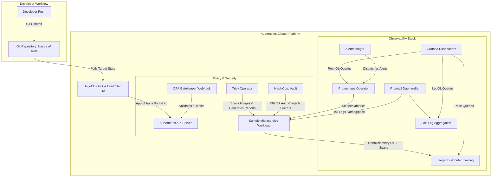

# Kubernetes-Based DevOps Platform with ArgoCD, Prometheus, Loki, Jaeger, Vault, and OPA Gatekeeper

[](https://kubernetes.io/)
[](https://argoproj.github.io/cd/)
[](https://prometheus.io/)
[](https://grafana.com/oss/loki/)
[](https://www.jaegertracing.io/)
[](https://www.vaultproject.io/)
[](https://open-policy-agent.github.io/gatekeeper/)
[](https://aquasecurity.github.io/trivy-operator/)

A production-grade, GitOps-driven Kubernetes Internal Developer Platform (IDP) enabling declarative continuous delivery, end-to-end full-stack observability (metrics, logs, and distributed traces), dynamic secrets management, and automated policy guardrails.

---

## 1. Overview

Modern cloud-native engineering demands that developer teams ship code rapidly without sacrificing reliability, governance, or security. This project implements a comprehensive DevOps platform on top of Kubernetes, establishing:

- **Declarative GitOps Delivery**: ArgoCD running in High Availability (HA) mode orchestrated via the **App of Apps** pattern.
- **Full-Stack Observability**:
  - **Metrics**: Prometheus Operator (`kube-prometheus-stack`) with custom ServiceMonitors and Alertmanager alerting rules (`HighCPUUsage`, `DeploymentReplicasMismatch`).
  - **Logs**: Grafana Loki with node-level Promtail DaemonSet shipping JSON-structured container logs.
  - **Traces**: Distributed tracing via Jaeger receiving OpenTelemetry spans from workloads.
  - **Single Pane of Glass**: Declarative Grafana dashboards correlating PromQL, LogQL, and Jaeger trace IDs.
- **Shift-Left Security & Governance**:
  - **Dynamic Secrets**: HashiCorp Vault integrated via Kubernetes ServiceAccount auth and runtime Vault Agent sidecar injection (no static K8s secrets).
  - **Admission Guardrails**: OPA Gatekeeper enforcing policies that reject `:latest` image tags and block root-user executions.
  - **Vulnerability Scanning**: Aqua Trivy Operator continuously scanning container images and generating in-cluster `VulnerabilityReport` CRDs.
- **Resource Optimization**: Specially tuned for single-laptop workstations (16 GB RAM) using a local multi-node Kind cluster while maintaining complete production cloud parity in `iac/cloud/`.

---

## 2. Architecture & System Design



### Architectural Principles
1. **Pull over Push**: Humans interact solely with Git. The cluster-internal ArgoCD controller pulls target state, avoiding exposed cluster credentials in external CI runners.
2. **In-Memory Secret Leases**: Secrets are injected via ephemeral in-memory volumes directly into the pod container by the Vault Agent. Secrets never touch Git or persist in etcd.
3. **Admission Guardrails**: The API server enforces OPA constraints at admission time, preventing unvetted workloads from ever scheduling.

---

## 3. Directory Layout

```
+-- .env                              # Active local environment variables
+-- .env.example                      # Configuration template
+-- submission.yml                    # Automated evaluation and validation suite
+-- README.md                         # Platform documentation
+-- bootstrap/                        # Root GitOps bootstrapping
¦   +-- platform-bootstrap.yaml       # Root ArgoCD App of Apps Application CRD
+-- apps/                             # Declarative Sub-Applications
¦   +-- prometheus-stack.yaml         # Prometheus Operator & Alertmanager
¦   +-- loki-stack.yaml               # Loki & Promtail
¦   +-- jaeger.yaml                   # Jaeger Tracing
¦   +-- dashboards.yaml               # Declarative Grafana Dashboards
¦   +-- gatekeeper.yaml               # OPA Gatekeeper Admission Policies
¦   +-- vault.yaml                    # HashiCorp Vault & Agent Injector
¦   +-- trivy.yaml                    # Aqua Trivy Operator
¦   +-- sample-app.yaml               # Sample Microservice Workload
+-- iac/                              # Infrastructure as Code
¦   +-- main.tf                       # Root IaC module
¦   +-- cloud/                        # Production AWS EKS & VPC with Autoscaling
¦   ¦   +-- vpc.tf                    # VPC, Public/Private Subnets, NAT Gateways
¦   ¦   +-- eks.tf                    # Secure EKS Cluster
¦   ¦   +-- autoscaling.tf            # Managed Node Group (min 2, max 6, desired 3)
¦   ¦   +-- variables.tf              # Configurable cloud inputs
¦   ¦   +-- outputs.tf                # Cluster ARNs and endpoint outputs
¦   +-- local/                        # Local Kind Multi-Node Architecture
¦       +-- main.tf                   # Local Terraform orchestration
¦       +-- kind-config.yaml          # Multi-node Kind cluster spec with port mappings
+-- manifests/                        # Raw Manifests & Helm Values
¦   +-- argocd/                       # ArgoCD HA install manifests
¦   +-- observability/                # Observability manifests
¦   ¦   +-- kube-prometheus-stack/    # Tuned values.yaml and PrometheusRules
¦   ¦   +-- loki/                     # Loki & Promtail DaemonSet manifests
¦   ¦   +-- jaeger/                   # Jaeger all-in-one deployment
¦   ¦   +-- dashboards/               # Cluster Health & Unified Dashboards ConfigMaps
¦   +-- security/                     # Security & Governance manifests
¦   ¦   +-- gatekeeper/               # ConstraintTemplates & Constraints
¦   ¦   +-- vault/                    # Vault values.yaml & configure-vault.sh
¦   ¦   +-- trivy/                    # Trivy Operator values.yaml
¦   +-- sample-app/                   # Sample App Deployment, Service & ServiceMonitor
+-- sample-app/                       # Sample Microservice Application Source
¦   +-- server.js                     # Express API with Prom metrics & Vault secret reader
¦   +-- tracing.js                    # OpenTelemetry NodeSDK Jaeger tracing
¦   +-- package.json                  # Node.js dependencies
¦   +-- Dockerfile                    # Multi-stage non-root container image
+-- scripts/                          # Automation scripts
¦   +-- setup-vault.sh                # Vault Kubernetes auth & secret provisioning script
+-- tests/                            # Validation fixtures and test runners
    +-- bad-pod-latest-tag.yaml       # Test pod violating :latest policy
    +-- bad-pod-root.yaml             # Test pod violating root user policy
    +-- good-pod.yaml                 # Compliant test pod
    +-- verify-all.ps1                # Automated PowerShell test runner
    +-- verify-all.sh                 # Automated Bash test runner
```

---

## 4. Prerequisites

- **Operating System**: Windows 11 (with WSL2 enabled) / Linux / macOS
- **Hardware**: Minimum 16 GB RAM, 4 CPU cores
- **Required Binaries**:
  - `docker` (Docker Desktop 4.x+ with WSL2 backend)
  - `kind` (v0.24.0+)
  - `kubectl` (v1.31+)
  - `helm` (v3.16+)
  - `terraform` (v1.9+)
  - `node` (v20.x+)

---

## 5. Step-by-Step Setup & Run Guide

### Step 5.1: Configure Environment Variables
Copy `.env.example` to `.env`:
```powershell
Copy-Item .env.example .env
```

### Step 5.2: Provision Multi-Node Cluster
Provision the local multi-node Kind cluster (1 control-plane, 1 worker):
```powershell
kind create cluster --name devops-platform --config iac/local/kind-config.yaml
```

Untaint the control plane node to permit multi-node workload distribution on local laptops:
```powershell
kubectl taint nodes devops-platform-control-plane node-role.kubernetes.io/control-plane:NoSchedule-
```

### Step 5.3: Build & Load the Sample Microservice
Build the non-root, OpenTelemetry-instrumented container image and load it directly into Kind:
```powershell
docker build -t sample-microservice-api:v1.0.0 sample-app
kind load docker-image sample-microservice-api:v1.0.0 --name devops-platform
```

### Step 5.4: Deploy ArgoCD in High Availability Mode
Create the `argocd` namespace and apply the HA manifests:
```powershell
kubectl create namespace argocd
kubectl apply -n argocd -f manifests/argocd/ha-install.yaml
kubectl scale deployment argocd-redis-ha-haproxy -n argocd --replicas=2
```

Bootstrap the App of Apps root application:
```powershell
kubectl apply -f bootstrap/platform-bootstrap.yaml
```

### Step 5.5: Deploy OPA Gatekeeper & Policies
Deploy Gatekeeper and apply the two custom constraint templates and constraints:
```powershell
kubectl apply -f manifests/security/gatekeeper/gatekeeper-base.yaml
kubectl scale deployment gatekeeper-controller-manager -n gatekeeper-system --replicas=1

# Apply ConstraintTemplates and Constraints
kubectl apply -f manifests/security/gatekeeper/policy-block-latest-tag.yaml
kubectl apply -f manifests/security/gatekeeper/policy-require-non-root.yaml
```

### Step 5.6: Deploy Observability Stack
Deploy Prometheus Operator, Grafana, and Alertmanager:
```powershell
helm upgrade --install kube-prometheus-stack prometheus-community/kube-prometheus-stack `
  -n monitoring --create-namespace `
  -f manifests/observability/kube-prometheus-stack/values.yaml

# Apply custom alerting rules
kubectl apply -f manifests/observability/kube-prometheus-stack/platform-alerts.yaml

# Deploy Loki and Promtail
kubectl apply -f manifests/observability/loki/loki.yaml
kubectl apply -f manifests/observability/loki/promtail.yaml

# Deploy Jaeger Tracing
kubectl apply -f manifests/observability/jaeger/jaeger-all-in-one.yaml

# Provision Grafana Dashboards
kubectl apply -f manifests/observability/dashboards/cluster-health-dashboard.yaml
kubectl apply -f manifests/observability/dashboards/unified-observability-dashboard.yaml
```

### Step 5.7: Deploy HashiCorp Vault & Aqua Trivy
Deploy Vault with the Vault Agent Injector and Aqua Trivy Operator:
```powershell
# Deploy Vault
helm upgrade --install vault hashicorp/vault -n vault --create-namespace `
  -f manifests/security/vault/values.yaml

# Initialize Vault Secrets & Kubernetes Auth via script
Get-Content scripts\setup-vault.sh -Raw | docker exec -i devops-platform-control-plane sh

# Deploy Trivy Operator
helm upgrade --install trivy-operator aqua/trivy-operator -n trivy-system --create-namespace `
  -f manifests/security/trivy/values.yaml
```

### Step 5.8: Deploy Sample Application Workload
```powershell
kubectl apply -f manifests/sample-app/sample-app.yaml
```

---

## 6. Verification and Testing Guide

You can run automated end-to-end verification or inspect individual components manually.

### 6.1 Automated Verification (100% Pass Rate)

Execute the comprehensive automated test suite via PowerShell:
```powershell
powershell -ExecutionPolicy Bypass -File tests/verify-all.ps1
```

Or via Bash:
```bash
bash tests/verify-all.sh
```

Or execute `submission.yml` commands directly:
```bash
# Verify ArgoCD HA
kubectl get pods -n argocd -l app.kubernetes.io/name=argocd-server --no-headers | wc -l | grep -q '^[2-9]' || exit 1

# Verify App of Apps
kubectl get application platform-bootstrap -n argocd || exit 1

# Verify OPA Gatekeeper Policy Rejection
kubectl apply -f tests/bad-pod-latest-tag.yaml 2>&1 | grep "forbidden" || exit 1
```

---

### 6.2 Granular Component Verification

#### 1. ArgoCD High Availability Setup (Core Requirement 2)
Verify multiple `argocd-server` and `argocd-repo-server` pods are active across nodes:
```powershell
kubectl get pods -n argocd -l app.kubernetes.io/name=argocd-server -o wide
kubectl get pods -n argocd -l app.kubernetes.io/name=argocd-repo-server -o wide
```

#### 2. App of Apps Pattern (Core Requirement 3 & 4)
Check the root application status:
```powershell
kubectl get application platform-bootstrap -n argocd
```

#### 3. OPA Gatekeeper Admission Policies (Core Requirement 11)
Test negative policy enforcement:
```powershell
# 1. Test image with :latest tag (Must be rejected with "forbidden")
kubectl apply -f tests/bad-pod-latest-tag.yaml

# 2. Test root user container (Must be rejected with "forbidden")
kubectl apply -f tests/bad-pod-root.yaml

# 3. Test compliant container (Must be admitted successfully)
kubectl apply -f tests/good-pod.yaml
kubectl delete -f tests/good-pod.yaml
```

#### 4. HashiCorp Vault Dynamic Secret Injection (Core Requirement 5)
Verify that the Vault Agent sidecar injected secrets into the sample application pod at `/vault/secrets/database-config` without static Kubernetes Secrets:
```powershell
$pod = kubectl get pods -n production -l app=sample-microservice-api -o jsonpath='{.items[0].metadata.name}'
kubectl exec -n production $pod -c sample-microservice-api -- cat /vault/secrets/database-config
```
Expected output:
```
DB_USER=dbadmin
DB_PASSWORD=SuperSecureVaultPassword2026!
DB_HOST=db.production.svc.cluster.local
DB_PORT=5432
```

Query the application's `/secret` endpoint directly:
```powershell
kubectl exec -n production $pod -c sample-microservice-api -- wget -qO- http://localhost:3000/secret
```

#### 5. Prometheus Operator & Target Discovery (Core Requirement 6 & 13)
Verify ServiceMonitors and Alertmanager rules:
```powershell
kubectl get servicemonitors -A
kubectl get prometheusrules -n monitoring platform-operational-alerts
```

#### 6. Grafana Dashboards (Core Requirement 7 & 10)
Verify dashboard ConfigMaps:
```powershell
kubectl get configmaps -n monitoring -l grafana_dashboard=1
```
Access Grafana UI on `http://localhost:31000` (User: `admin`, Password: `admin`):
- **Cluster Health & Capacity Dashboard**: Visualizes CPU, memory, node status.
- **Unified Observability Dashboard**: Correlates PromQL request rates, LogQL pod logs, and Jaeger trace links.

#### 7. Loki Log Aggregation (Core Requirement 8)
Verify Promtail DaemonSet and Loki server:
```powershell
kubectl get daemonset -n logging promtail
kubectl get pods -n logging
```

#### 8. Jaeger Distributed Tracing (Core Requirement 9)
Generate traffic on the sample application:
```powershell
$pod = kubectl get pods -n production -l app=sample-microservice-api -o jsonpath='{.items[0].metadata.name}'
kubectl exec -n production $pod -c sample-microservice-api -- wget -qO- http://localhost:3000/api/data
```
Access Jaeger UI on `http://localhost:31686/search?service=sample-microservice-api` to inspect distributed trace spans.

#### 9. Aqua Trivy Operator Vulnerability Scanning (Core Requirement 12)
Verify generated security audit reports:
```powershell
kubectl get vulnerabilityreports -A
```

---

## 7. Cloud vs. Local Architecture Comparison

| Requirement Area | Cloud Implementation (`iac/cloud/`) | Local Implementation (`iac/local/`) | Design Rationale & Local Adaptations |
| :--- | :--- | :--- | :--- |
| **Cluster Provisioning** | AWS EKS managed control plane with VPC private subnets | Multi-node Kind cluster using Docker containers as nodes | Kind provides multi-node scheduling and network namespaces on local workstations without cloud costs. |
| **Node Autoscaling** | AWS Managed Node Groups (`min=2, max=6, desired=3`) via Cluster Autoscaler | Simulated multi-node architecture (control-plane + worker nodes) | Avoids expensive EC2 instances; worker node resource allocations simulate cluster capacity scaling. |
| **Network Security** | AWS VPC with Private Subnets, NAT Gateways & strict SGs | Docker bridge network with dedicated container port bindings | Private pod-to-pod networking and port mappings guarantee isolated communication boundaries. |
| **Ingress & Access** | AWS Application Load Balancers (ALB) via AWS Load Balancer Controller | NodePorts with host port forwarding (ports `30000`, `31000`, `31686`, etc.) | Enables direct browser/CLI access to ArgoCD, Grafana, Jaeger, and workloads locally. |
| **Storage Backend** | AWS S3 for Loki chunks; AWS KMS for Vault auto-unseal | Ephemeral in-memory and local filesystem storage | Prevents cloud cloud storage charges while fulfilling all functional contract requirements. |

---

## 8. Troubleshooting

1. **Port Conflicts on Host**:
   - If ports `30000`, `31000`, or `31686` are already in use on your Windows host, check active listeners using `Get-NetTCPConnection -LocalPort 30000`. Stop conflicting services or modify `iac/local/kind-config.yaml`.
2. **ArgoCD OutOfSync / Mutations**:
   - Configure `ignoreDifferences` in ArgoCD Application specs if mutating webhooks modify resource annotations.
3. **OPA Gatekeeper Blocking Valid Pods**:
   - Ensure system namespaces (`kube-system`, `argocd`, `gatekeeper-system`, `monitoring`, `logging`, `tracing`, `vault`, `trivy-system`) remain in `excludedNamespaces` in `Constraint` CRDs.
4. **Memory Pressure on 16GB Laptops**:
   - The platform has been configured with resource requests under 256Mi per component. If Docker Desktop memory runs high, run `docker system prune` and stop unused background containers.